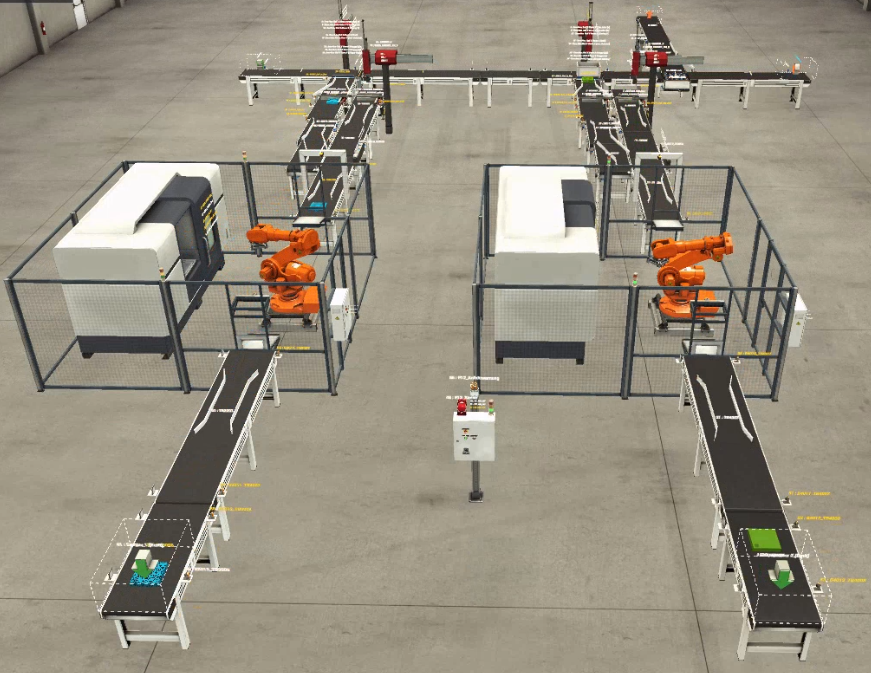

# 🚀 Projekt 047 – Factory I/O: Montage und Kommissionierung (S7-300)


## 📌 Projektübersicht

Dieses Projekt behandelt die **SPS-gesteuerte Montage und Kommissionierung einer automatisierten Fertigungsanlage**. Die Abläufe werden in **Siemens TIA Portal V17** programmiert und mit einer **Factory-I/O-3D-Szene** abgebildet.

Im Anlagenteil **Kommissionierung (Teil 4)** werden fertig montierte blaue und grüne Produkte in Stapelboxen übernommen. Zwei Pick-and-Place-Manipulatoren greifen die Produkte, legen sie in positionierte Boxen ab und geben den anschließenden Transport frei. Ein Rollensorter leitet den Materialfluss abhängig von der Farberkennung zur jeweiligen Abgabestrecke.

Das bereitgestellte TIA-Portal-Projekt enthält darüber hinaus die vorgeschalteten Montage- und Bearbeitungsschritte für blaue und grüne Produkte. Die Factory-I/O-Szene ist entsprechend als zusammengeführte Fertigungsanlage angelegt.

> **Hinweis zur SPS-Baureihe:** Im bereitgestellten TIA-Portal-Export ist **PLC_WBS_Bus_1 – CPU 314C-2 DP (S7-300)** dokumentiert. Die ursprünglich vorgeschlagene Bezeichnung `s7-1500` wäre deshalb für diese Projektversion nicht korrekt.

---

## ⚙️ Projektmerkmale

- Automatisierter Materialfluss in einer verketteten Fertigungsanlage
- Verarbeitung und Verteilung **blauer und grüner Produkte**
- Zuführung und Positionierung von Stapelboxen mit Förderbändern und Stoppern
- **Zwei Pick-and-Place-Manipulatoren** zur Kommissionierung
- Steuerung der Greifer sowie der **X- und Z-Achsen**
- Farberkennung und Verzweigung des Ablaufs in zwei Transportwege
- Sortierung über einen Rollen-/Schwenksorter
- Strukturierte SPS-Programmierung mit **OB, FB, FC und DB**
- **SCL-Schrittketten** mit `CASE`-Anweisungen und Zustandsvariablen
- **10 Sekunden Anlaufwarnung** mit Sirene und Rundumleuchte
- Bedienung über Hauptschalter, START, STOP und NOT-HALT
- Modellierung und Untersuchung der Abläufe in Factory I/O

---

## 🧰 Verwendete Technologien

| Komponente | Beschreibung |
|---|---|
| SPS | Siemens SIMATIC **S7-300 – CPU 314C-2 DP** |
| Engineering | **TIA Portal V17** |
| Programmiersprachen | **SCL** (Funktionsbausteine), **FUP** (OB1) |
| Anlagensimulation | **Factory I/O 2.5.5** (Version der gespeicherten Szene) |
| SPS-Simulation | SIMATIC S7-PLCSIM V17 als Projektumgebung / Prüfwerkzeug |
| Feldsignale | Digitale Sensor-/Aktor- und analoge Positions-Sollwertsignale |
| Projektunterlagen | TIA-Portal-Archiv `.zap17`, Factory-I/O-Szene `.factoryio`, Pflichtenheft, Zeitplan, Programmexport |

---

## 🏭 Anlagenaufbau

Die Kommissionierung setzt sich aus folgenden Komponenten zusammen:

| Anlagenteil | Funktion |
|---|---|
| **TB5001** | Zuführung der leeren Stapelboxen |
| **STOP5001–STOP5005** | Positionierung / Rückhaltung an Übergabestellen |
| **Pick-and-Place 1 und 2** | Aufnahme und Ablage der Produkte in Stapelboxen |
| **TB5002–TB5010** | Transport der Produkte bzw. belegten Stapelboxen |
| **B5011 / B5012** | Unterscheidung zwischen grünem und blauem Produkt |
| **RS5001** | Sortierung in die vorgesehenen Abgabestrecken |
| **Emitter** | Erzeugung und Bereitstellung des Materials in der Simulation |
| **Remover** | Entfernung des Materials am Ende der Transportstrecke |
| **Schaltkasten und Signalleuchten** | Bedienung und Betriebszustandsanzeige |

Die zugehörige Factory-I/O-Szene umfasst eine größere, zusammengeführte Produktionsanlage. In der gespeicherten Szene sind unter anderem Förderbänder, Lichtschranken, Emitter, Bearbeitungsstationen, Pick-and-Place-Einheiten und Sorter vorhanden.

---

## 🖼️ Projektbild – Factory-I/O-Gesamtanlage



*Abbildung: Gesamtansicht der Factory-I/O-Simulationsanlage mit Förderstrecken, zwei Roboter-/Bearbeitungszellen, Übergabe- und Sortierbereichen sowie einem zentralen Bedienpult.*

---

## 🔁 Funktions- und Prozessablauf

1. **Einschalten:** Der Hauptschalter gibt die Anlage grundsätzlich frei.
2. **START:** Bei erfüllter Freigabe wird die Anlaufsequenz ausgelöst.
3. **Anlaufwarnung:** Sirene und gelbe Rundumleuchte werden für **10 s** aktiviert.
4. **Stapelboxzuführung:** Eine leere Box wird zugeführt und an der Bearbeitungsposition durch Stopper gehalten.
5. **Materialbereitstellung:** Ein blaues oder grünes Produkt wird bereitgestellt.
6. **Pick-and-Place:** Der zuständige Manipulator fährt die X-/Z-Achsen an, nimmt das Produkt auf und legt es in der Box ab.
7. **Transportfreigabe:** Nach dem Fertigsignal des Greifarms wird die Box weiterbefördert.
8. **Farberkennung:** Die Sensorsignale bestimmen den weiteren Transportweg.
9. **Sortierung:** Der Rollensorter führt das Material zur zugehörigen Abgabestrecke.
10. **Abgabe:** Das Material erreicht das Streckenende und wird durch einen Remover entfernt.

Die Steuerung berücksichtigt dabei Freigabesignale, Anwesenheitssensoren und Rückmeldungen der Manipulatoren.

---

## 🧱 SPS-Programmstruktur

### OB1 – Hauptprogramm

`Main [OB1]` ist in **FUP** erstellt. Er organisiert die zyklischen Aufrufe der Stationen der Gesamtanlage, einschließlich Montage, Bearbeitung, Kommissionierung, Anlagenfreigabe, Förderband und Greifarmen.

### Bausteine für die Kommissionierung

| Baustein | Bezeichnung | Aufgabe |
|---|---|---|
| `FC1` | `01_NotAus_STO` | Verarbeitung des NOT-HALT-Signals als Programmfreigabe |
| `FB9` | `02_AnlageEinAus` | Betriebszustände, START/STOP, Anlaufwarnung und Meldeleuchten |
| `FB2` | `03_Förderband` | Schrittgesteuerter Transport, Stopper, Emitter und Farbsortierung |
| `FB3` | `04_Greifarm` | Pick-and-Place-Ablauf mit Achssteuerung und Greifer |
| `DB29` | `02_AnlageEinAus_DB` | Instanzdaten für die Anlagensteuerung |
| `DB30` | `03_Förderband_DB` | Instanzdaten für den Förderbandablauf |
| `DB31` / `DB32` | `04_Greifarm_DB` / `04_Greifarm_DB_1` | Instanzdaten der zwei Greifarm-Aufrufe |
| `DB100` | `100_DB_Kommissionierung` | Übergreifende Status-, Schritt- und Meldedaten |

**Zusätzliche FBs der Gesamtanlage:** Das importierte TIA-Projekt enthält außerdem vor- und nachgelagerte Funktionen für Transportbänder, Bearbeitung, Weiterverarbeitung, Zusammenbau, Weitergabe und Auswahl von Ober-/Unterteilen für beide Produktfarben.

---

## 💻 SCL-Programmierung

### 1. Anlaufwarnung mit IEC-Timer

Die Anlaufsteuerung verwendet einen `TON`-Timer mit einer Dauer von zehn Sekunden. Auszug aus `FB9`:

```scl
#IEC_Timer_0_AnlageEinAus(
    IN := #stat_xAnlageStartet,
    PT := T#10s
);
```

Nach Ablauf des Timers wird der Anlagenstartzustand in den Automatikbetrieb überführt. Während des Anlaufs werden Sirene und Rundumleuchte angesteuert.

### 2. Farberkennung und Schrittauswahl

Die Schrittkette in `FB2` verwendet einen Integer-Schrittindex und `CASE`, um die Reihenfolge der Transportvorgänge zu verwalten. Ein Auszug aus der Farberkennung:

```scl
IF #B5012_Farbteil_BL THEN
    #stat_iIndex := 110;
END_IF;

IF #B5011_Farbteil_GN THEN
    #stat_iIndex := 210;
END_IF;
```

| Zustandsbereich / Schritt | Bedeutung |
|---|---|
| `100–104` | Zuführung, Positionierung, Übergabe und Farberkennung |
| `110–111` | Transport und Abgabe des blauen Produkts |
| `200–203` | Zuführung und Übergabe für den weiteren Materialweg |
| `210–211` | Transport und Abgabe des grünen Produkts |

### 3. Greifarmsteuerung

`FB3` steuert die Bewegungsfolge der Greifarme. Wichtige Bedingungen sind eine vorhandene Stapelbox, ein verfügbares Produkt, eine Anlagenfreigabe und der passende Förderbandschritt. Zur Achsauswertung werden Rückmeldesignale der X- und Z-Achse und Flankenerkennung verwendet. Nach Abschluss der Ablage wird `xBoxFertig` gesetzt, damit der Weitertransport beginnen kann.

---

## 🔌 Signalübersicht (Auszug aus der TIA-Dokumentation)

| Signal | Adresse | Beschreibung |
|---|---|---|
| `S0_HS` | `%E0.0` | Hauptschalter |
| `S1_Not_Halt` | `%E0.1` | NOT-HALT-Eingang |
| `S2_START` | `%E0.2` | START |
| `S3_STOP` | `%E0.3` | STOP |
| `P12_Anfahrwarnung` | `%A0.6` | Rundumleuchte |
| `P13_Sirene` | `%A0.7` | Sirene |
| `TB5001` | `%A8.0` | Förderband Stapelboxzuführung |
| `STOP5001` | `%A9.2` | Stopper 1 |
| `STOP5002` | `%A9.3` | Stopper 2 |
| `Emitter_1` | `%A11.5` | Materialbereitstellung |
| `TA_P&P1_SetPoint_X` | `%AW20` | X-Sollwert für Pick-and-Place 1 |
| `TA_P&P1_SetPoint_Z` | `%AW22` | Z-Sollwert für Pick-and-Place 1 |
| `TA_P&P2_SetPoint_X` | `%AW24` | X-Sollwert für Pick-and-Place 2 |
| `TA_P&P2_SetPoint_Z` | `%AW26` | Z-Sollwert für Pick-and-Place 2 |

Die vollständige E/A-Zuordnung ist dem TIA-Portal-Projekt zu entnehmen. Die Namen der Signale und die Zuordnungen entsprechen dem vorliegenden Export.

---

## 🛑 Bedienung, Sicherheit und Wiederanlauf

Das Pflichtenheft beschreibt folgende Betriebszustände:

| Betriebszustand | Vorgesehenes Verhalten |
|---|---|
| **AUS / Grundzustand** | Keine automatische Bewegung |
| **ANLAUF** | 10 s Anlaufwarnung |
| **AUTOMATIK** | Automatisierter Montage-/Kommissionierungsablauf |
| **STOP** | Aktuellen Teilprozess abschließen, anschließend keinen neuen starten |
| **NOT-HALT** | Aktoren deaktivieren und automatischen Wiederanlauf verhindern |

**Sicherheitshinweis:** `01_NotAus_STO [FC1]` ist im Projekt als Anwendungslogik dokumentiert. Eine echte, sicherheitsgerichtete STO-/NOT-HALT-Funktion darf daraus **nicht** abgeleitet werden. Für eine reale Maschine wären eine unabhängige Sicherheitsauslegung, geeignete F-Hardware beziehungsweise sichere Antriebsfunktionen und deren Validierung erforderlich. Auch das tatsächliche STOP- und Wiederanlaufverhalten muss anhand der SPS-Logik geprüft werden.

---

## 🧪 Simulation und Funktionstests

Das Pflichtenheft nennt folgende Testfälle. Sie sind hier als **Prüfplan**, nicht als unabhängig verifizierter Testnachweis, aufgeführt:

| Test | Prüfung | Erwartetes Ergebnis |
|---|---|---|
| T-001 | START | 10 s Anlaufwarnung, danach Automatik |
| T-002 | STOP während eines Teilprozesses | Teilprozess abschließen, keinen neuen starten |
| T-003 | NOT-HALT | Aktoren werden deaktiviert |
| T-004 | Entriegelung nach NOT-HALT | Kein selbsttätiger Wiederanlauf |
| T-005 | Stapelboxzuführung | Box erreicht ihre Position |
| T-006 | Pick-and-Place | Produkt wird korrekt abgelegt |
| T-007 | Transport | Belegte Box wird weitertransportiert |
| T-008 | Sortierung | Box gelangt zur vorgesehenen Strecke |
| T-009 | Abgabe | Material wird am Ende entfernt |
| T-010 | Wiederholter Gesamtzyklus | Mehrere Zyklen ohne unzulässigen Zustandswechsel |

**Projektstand:** SPS-Programm, Factory-I/O-Szene, Pflichtenheft und Zeitplan liegen vor. Das Vorhandensein der Dateien allein belegt noch keine erfolgreiche Durchführung sämtlicher Abnahmetests.

---

## 📚 Projektgrundlagen

- **Pflichtenheft:** „Fertigungsanlage – Teil 4 – Kommissionierung“, Version 1.0 vom 08.10.2026
- **TIA-Portal-Export:** `08_Ende_Montage_Kommiss.pdf` (138 Seiten)
- **TIA-Portal-Archiv:** `Ende_Montage_Kommiss_20261020_20261027_2016.zap17`
- **Factory-I/O-Szene:** `08_Fertigung_Montage_Kommiss_SIM.factoryio`
- **Projektplanung:** `Zeitplan Kommissionierung.xlsx`
- Grundlage: Praktikumsaufgabe zur Fertigungsanlage, WBS TRAINING AG

---

## 👨‍💻 Dokumentation und Kontakt

**Wessam Abo Zayed**  
*Automatisierungstechnik | SPS-/PLC-Programmierung | Data Analyst*

| Kontakt | Link |
|---|---|
| **E-Mail** | [abozayed.wessam@gmail.com](mailto:abozayed.wessam@gmail.com) |
| **LinkedIn** | [linkedin.com/in/wessam-abozayed](https://www.linkedin.com/in/wessam-abozayed/) |
| **GitHub** | [github.com/wessam-abo-zayed](https://github.com/wessam-abo-zayed) |
| **Tableau Public** | [public.tableau.com/app/profile/wessam3726](https://public.tableau.com/app/profile/wessam3726) |

*Schulungs- und Simulationsprojekt. Die README beschreibt die vorliegenden Projektdateien und unterscheidet Projektanforderungen von nachgewiesenen Testergebnissen.*
