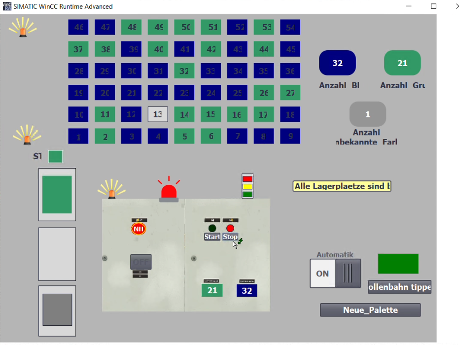
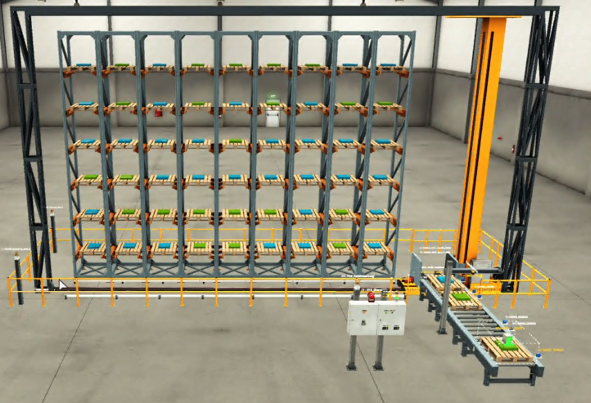
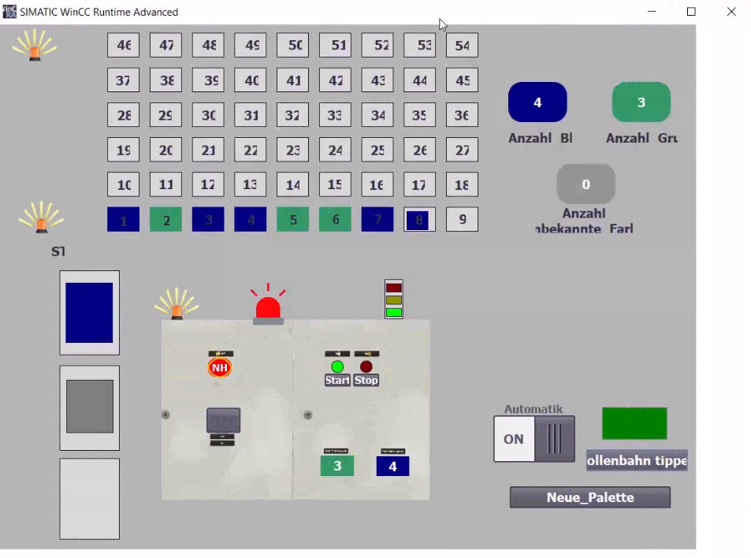
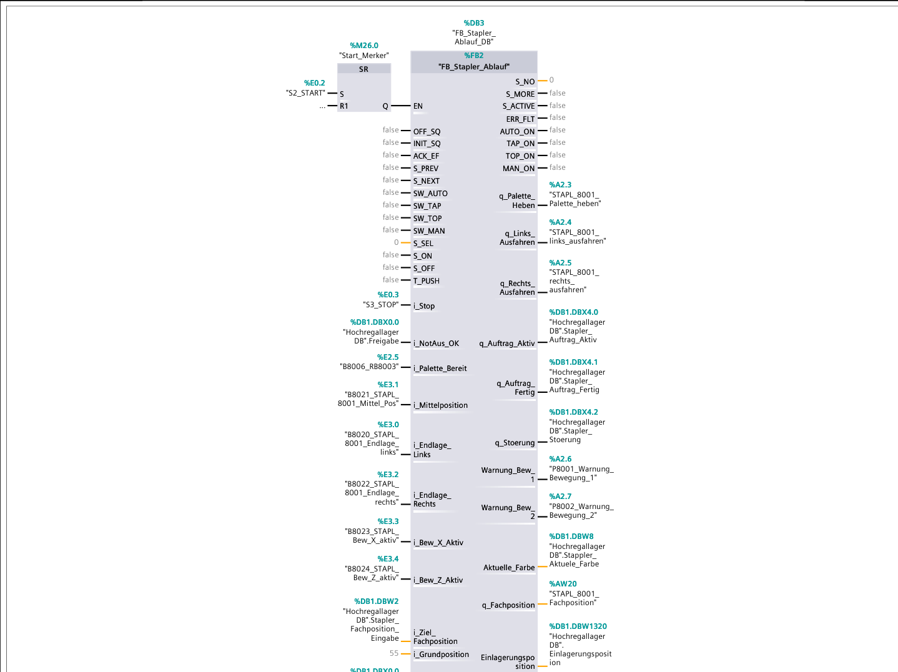
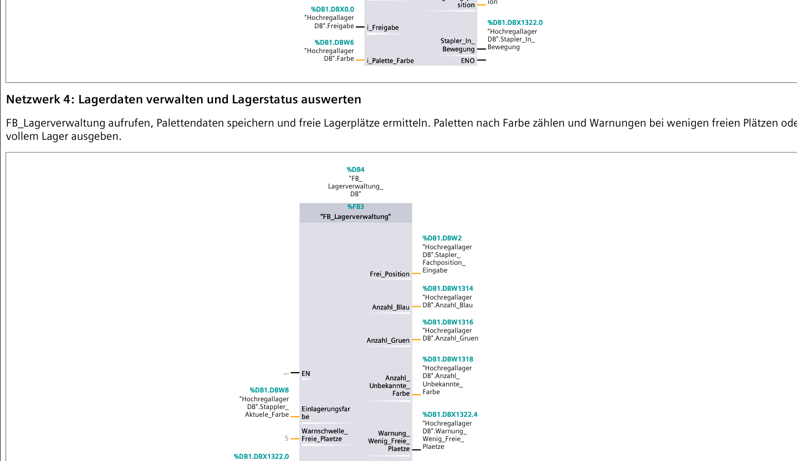
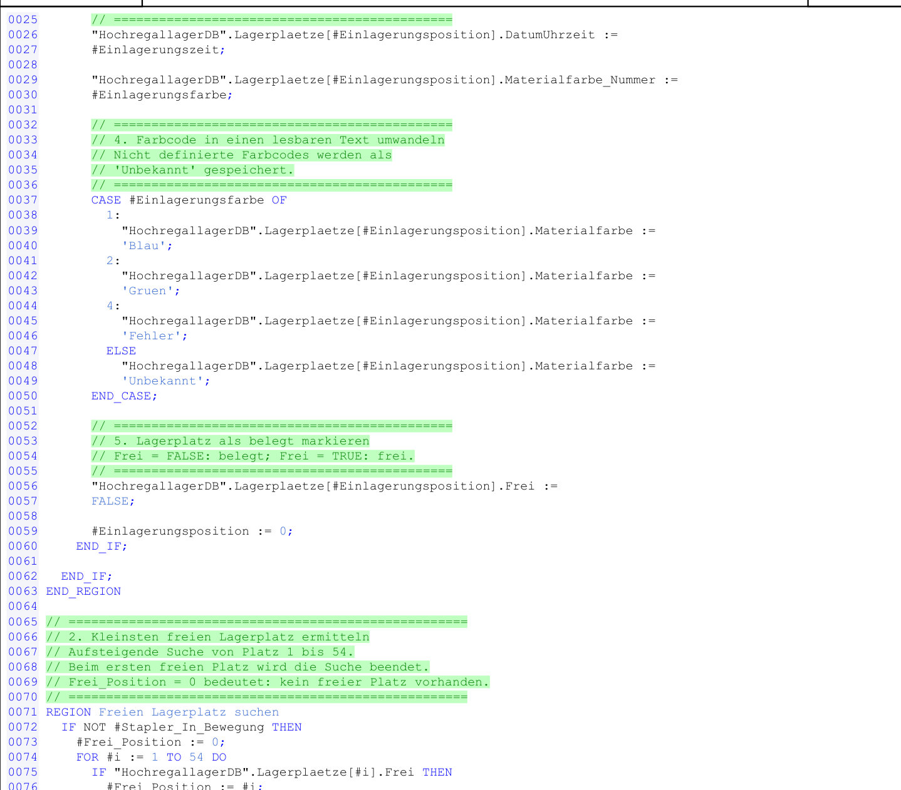

# 🚀 Automatisiertes Hochregallager mit Siemens S7-300 und Factory I/O

### Projekt 048 · Lagerautomation · S7-GRAPH · SCL · FUP · AWL · WinCC Runtime Advanced

## 📌 Projektübersicht

Dieses Projekt realisiert die **SPS-Steuerung eines automatisierten Hochregallagers** als Teil einer virtuellen Fertigungsanlage in **Factory I/O**. Die Aufgabe besteht darin, Paletten mit montierten Produkten von einer Förderstrecke zu übernehmen, ihre Farbe zu erkennen und sie mit einem Regalstapelgerät auf freie Lagerplätze zu verteilen.

Die Anlage verfügt über **54 Lagerfächer**; **Position 55** ist die Übergabeposition des Regalgeräts. Die Position **0** ist für das Halten der Position vorgesehen. Das SPS-Programm wurde in **TIA Portal V17** für eine **SIMATIC S7-300 CPU 314C-2 DP** erstellt. Zum Einsatz kommen insbesondere **FUP**, **S7-GRAPH**, **SCL** und unterstützende **AWL**-Bausteine.

Zusätzlich ist eine **WinCC Runtime Advanced**-Visualisierung Bestandteil des Projekts. Das Lager wurde in einer Gruppenarbeit entwickelt und anschließend mit dem Anlagenteil **Versand** zu einer gemeinsamen Steuerungslösung zusammengeführt.

> **Projektname in TIA Portal:** `11_End_LAGER_Projekt_261019`  
> **GitHub-Repository:** `048-s7-300-factory-io-hochregallager`

---

## 📷 Projektbilder – Factory I/O und WinCC

### WinCC-Lagerübersicht – Belegtes Hochregallager



*WinCC Runtime Advanced: farbcodierte Darstellung der 54 Lagerfächer mit 32 blauen, 21 grünen und einem Teil unbekannter Farbe. Zusätzlich sind Bedienpanel, Betriebsanzeigen und die Schaltflächen für Automatikbetrieb, Rollenbahn und neue Palette zu sehen.*

### Factory-I/O-Simulation – Gesamtanlage



*3D-Ansicht der Factory-I/O-Anlage mit mehrstöckigem Regalsystem, Regalstapelgerät, Rollenbahnen und Bedienpult.*

### WinCC-Lagerübersicht – Teilbelegung



*WinCC Runtime Advanced: Beispiel einer teilweise belegten Anlage mit vier blauen und drei grünen Paletten sowie freien Lagerplätzen. Die Anzeige veranschaulicht die dynamische Belegungs- und Mengendarstellung.*

---

## 🎯 Projektziele

- Automatisierte Annahme und Förderung von Paletten über drei Rollenbahnen.
- Erkennung blauer und grüner Teile mithilfe optischer Sensoren.
- Steuerung der Palettenaufnahme, Fahrbewegung und Einlagerung über ein Regalstapelgerät.
- Verwaltung von **54 Lagerfächern** mit Belegungsstatus, Materialfarbe und Einlagerungszeit.
- Suche nach dem nächsten verfügbaren Lagerplatz und Überwachung der Lagerkapazität.
- Erfassung und Anzeige der Anzahl blauer und grüner Teile.
- Umsetzung eines Bedienkonzepts mit START, STOP, NOT-HALT, Anlaufwarnung und Betriebsanzeigen.
- Visualisierung des Anlagenzustands und der Regalbewegung in WinCC.
- Integration der einzelnen Programmteile und Anbindung an die Versandsteuerung.

---

## ⚙️ Hardware und Software

| Komponente | Beschreibung |
|---|---|
| SPS | **Siemens SIMATIC S7-300 – CPU 314C-2 DP** |
| Artikelnummer | `6ES7 314-6CH04-0AB0` |
| CPU-Firmware | V3.3 (Projektkonfiguration) |
| Engineering | **Siemens TIA Portal V17** |
| Simulation | **Factory I/O**, Szene `05_Lager_SIM.factoryio` |
| Bedienoberfläche | **SIMATIC WinCC Runtime Advanced** |
| Programmiersprachen | **FUP**, **S7-GRAPH**, **SCL**, **AWL** |
| Logische Peripherie | Digital-E/A, Sensorsignale und Aktoren der Factory-I/O-Anlage |
| Regalfächer | **1–54** |
| Übergabeposition | **55** |
| Halteposition | **0** |

Die Steuerung ist als S7-300 projektiert, **nicht als S7-1500**. Die digitale E/A-Zuordnung ist in der mitgelieferten Projektdokumentation enthalten.

---

## 🏗️ Anlagenstruktur

```text
                  ┌───────────────────────────────┐
                  │ Emitter_1: Palette bereitstellen │
                  └──────────────┬────────────────┘
                                 ▼
                     ┌─────────────────────┐
                     │ Rollenbahnen 1–3    │
                     │ RB8001 / 02 / 03    │
                     └──────────┬──────────┘
                                ▼
                     ┌─────────────────────┐
                     │ Optische Sensoren   │
                     │ Blau / Grün         │
                     └──────────┬──────────┘
                                ▼
                  ┌───────────────────────────────┐
                  │ Regalstapelgerät, Position 55 │
                  │ Palette aufnehmen             │
                  └──────────────┬────────────────┘
                                 ▼
                  ┌───────────────────────────────┐
                  │ Freies Lagerfach suchen       │
                  │ Position 1 ... 54 anfahren   │
                  └──────────────┬────────────────┘
                                 ▼
                  ┌───────────────────────────────┐
                  │ Palette ablegen, Daten sichern│
                  │ und zur Position 55 zurück   │
                  └───────────────────────────────┘
```

### Regalsystem und Positionierung

- **54 Fachpositionen** zur Aufnahme von Paletten.
- **Position 55** zur Palettenübergabe.
- **Position 0** zur Positionshaltung entsprechend der vorgegebenen Anlagenschnittstelle.
- Endlagensignale für **links**, **Mittelposition** und **rechts**.
- Separate Signale zur Erkennung von Bewegungen in **X- und Z-Richtung**.

---

## 🧱 SPS-Programmstruktur

Die Projektstruktur basiert auf einem zentralen Aufrufbaustein sowie getrennten Bausteinen für Fördertechnik, Ablaufsteuerung, Lagerverwaltung und Bedienung.

| Baustein | Sprache | Funktion |
|---|---|---|
| `Main [OB1]` | FUP | Zyklischer Programmaufruf von `Lager_Aufrufen` |
| `Lager_Aufrufen [FB4]` | FUP | Zentrale Koordination der Lagerfunktionen |
| `FB_Paketempfang_Rollenbahn [FB1]` | FUP | Förderbandsteuerung, Palettenübergabe und Farberkennung |
| `FB_Stapler_Ablauf [FB2]` | **S7-GRAPH** | Schrittkettensteuerung der Palettenaufnahme und Einlagerung |
| `FB_Lagerverwaltung [FB3]` | **SCL** | Lagerplatzsuche, Datenhaltung, Farbstatistik und Kapazitätsüberwachung |
| `FB_ControlPanel [FB10]` | FUP | Anlagenfreigabe, Bedienung und Betriebs-/Warnsignale |
| `FC_HMI_Bewegung [FC1]` | SCL | Berechnung der HMI-Verschiebungswerte in X- und Z-Richtung |
| `HochregallagerDB [DB1]` | DB | Zentrale Prozess- und Lagerdaten, darunter die 54 Lagerplätze |
| `FB_Paketempfang_Rollenbahn_DB [DB2]` | DB | Instanzdaten für die Fördertechnik |
| `FB_Stapler_Ablauf_DB [DB3]` | DB | Instanzdaten der GRAPH-Schrittkette |
| `FB_Lagerverwaltung_DB [DB4]` | DB | Instanzdaten der Lagerverwaltung |
| `FB_ControlPanel_DB [DB7]` | DB | Instanzdaten der Bedienlogik |
| `HMI_Eingaben_DB [DB8]` | DB | HMI-Befehle wie Start, Stopp und Not-Halt |

Das Projekt enthält darüber hinaus **AWL-Hilfsbausteine** zum Durchsuchen und Beschreiben von Lagerfächern, beispielsweise `Suche_Leeres_Fach [FC101]`, `Suche_Blau [FC102]`, `Suche_Grün [FC103]` und `Lagerfach_beschreiben [FC104]`. Diese sind in der Dokumentation als eigene Bibliotheks- bzw. Hilfsfunktionen vorhanden; ihre Verwendung im zentralen Programm ist gesondert von der SCL-Lagerverwaltung zu betrachten.

### S7-GRAPH – Staplerablauf



*Abbildung: Aufruf des `FB_Stapler_Ablauf [FB2]` mit Sensoren, Fahrbefehlen und Bewegungsrückmeldungen aus der TIA-Portal-Dokumentation.*

### Lagerverwaltung im FUP-Hauptprogramm



*Abbildung: Anbindung von `FB_Lagerverwaltung [FB3]` an die zentralen Lagerdaten und Warnsignale.*

---

## 🔄 Funktionsbeschreibung

### 1. Anlagenfreigabe und Anlauf

Der Anlagenzustand wird durch `FB_ControlPanel [FB10]` verarbeitet. Die Bedienlogik berücksichtigt Hauptschalter, START, STOP, NOT-HALT sowie den Betriebsstatus der Factory-I/O-Simulation.

Vor dem Start ist eine **Anlaufwarnung von etwa 10 Sekunden** mit Sirene und Rundumleuchte vorgesehen; im Projekt ist dafür ein `TP`-Timer mit `T#10s` dokumentiert. Die Betriebszustände werden über Meldeleuchten und Leuchttaster signalisiert.

### 2. Palettentransport und Farberkennung

`FB_Paketempfang_Rollenbahn [FB1]` verarbeitet die Fördertechnik und den Palettenfluss. Die Anlage verwendet drei Rollenbahnen sowie optische Signale zur Klassifizierung der Werkstücke:

| Signal | Funktion |
|---|---|
| `B8007_OT_BL` | Erkennung blaues Material |
| `B8008_OT_GN` | Erkennung grünes Material |
| `B8001` bis `B8006` | Sensoren an den Rollenbahnen |
| `RB8001` bis `RB8003` | Ansteuerung der drei Rollenbahnen |
| `Emitter_1` | Bereitstellung neuer Paletten |

### 3. Palettenaufnahme und Einlagerung

Der Baustein `FB_Stapler_Ablauf [FB2]` steuert den Ablauf als **S7-GRAPH-Schrittkette**. Er verarbeitet unter anderem:

- Palettenbereitschaft an der Förderstrecke.
- Ausfahren, Heben und Einfahren der Palettenübernahme.
- Rückmeldungen der linken, mittleren und rechten Endlage.
- Anwahl der Lagerfachposition und Fahrbewegung.
- Abschlussmeldung des Einlagerungsauftrags.

Nach Abschluss der Einlagerung wird die Übergabeposition **55** wieder angefahren.

### 4. Lagerverwaltung und Materialdaten

Der SCL-Baustein `FB_Lagerverwaltung [FB3]` verwaltet die Daten aller 54 Lagerplätze. Für jedes Lagerfach werden die folgenden Informationen verwendet:

| Datenfeld | Beschreibung |
|---|---|
| `Frei` | `TRUE` = frei, `FALSE` = belegt |
| `Materialfarbe` | Textdarstellung wie `Blau` oder `Gruen` |
| `Materialfarbe_Nummer` | Numerischer Farbcode |
| `DatumUhrzeit` | Zeitpunkt der Einlagerung |

Die Zuordnung der Materialfarben erfolgt im SCL-Code:

| Farbcode | Bedeutung |
|---|---|
| `1` | Blau |
| `2` | Grün |
| `4` | Fehler |
| Sonstiger Wert | Unbekannt |

Ein Lagerfach darf nur beschrieben werden, wenn seine Nummer im Bereich **1–54** liegt und sein Belegungsstatus `Frei = TRUE` ist. Der Zeitstempel wird mit `RD_SYS_T` eingelesen.

### 5. Freien Lagerplatz ermitteln

Die Suche durchläuft das Lager aufsteigend von Fach 1 bis Fach 54. Der **erste freie Platz** wird als `Frei_Position` ausgegeben; `0` bedeutet, dass kein freier Lagerplatz gefunden wurde.

Ein gekürzter Auszug der tatsächlichen SCL-Logik:

```scl
IF NOT #Stapler_In_Bewegung THEN
    #Frei_Position := 0;

    FOR #i := 1 TO 54 DO
        IF "HochregallagerDB".Lagerplaetze[#i].Frei THEN
            #Frei_Position := #i;
            EXIT;
        END_IF;
    END_FOR;
END_IF;
```



*Abbildung: Auszug aus der dokumentierten SCL-Lagerverwaltung mit Material- und Lagerplatzlogik.*

### 6. Lagerkapazität und Statusanzeigen

Die Lagerverwaltung zählt die belegten blauen und grünen Plätze, führt eine separate Zählung für unbekannte beziehungsweise fehlerhafte Farbwerte und ermittelt die Anzahl freier Lagerplätze.

- **Wenige freie Plätze:** Warnschwelle ist im zentralen Baustein auf **5** freie Plätze gesetzt.
- **Lager voll:** `Lager_Voll = TRUE`, wenn die Zahl freier Plätze **0** ist.
- **Betriebsanzeigen:** Signalisierung von Bereitschaft, Warnung, Störung und Bewegung.

Im Programm werden zusätzliche Datensätze eines wieder freigegebenen Lagerplatzes zurückgesetzt. Dazu gehören der Farbtext, der numerische Farbcode und der Zeitstempel.

---

## 🔌 Signalübersicht

Die nachfolgenden Adressen sind der bereitgestellten E/A-Zuordnung und dem TIA-Portal-Export entnommen.

### Digitale Eingänge

| Signal | Adresse | Beschreibung |
|---|---|---|
| `S0_HS` | `%E0.0` | Hauptschalter |
| `S1_Not_Halt` | `%E0.1` | NOT-HALT-Eingang |
| `S2_START` | `%E0.2` | START |
| `S3_STOP` | `%E0.3` | STOP |
| `Factory_IO_RUN` | `%E1.7` | Rückmeldung der Simulation |
| `B8001_RB8001` | `%E2.0` | Rollenbahn 1 – Anfangssensor |
| `B8006_RB8003` | `%E2.5` | Rollenbahn 3 – Endsensor |
| `B8007_OT_BL` | `%E2.6` | Farberkennung Blau |
| `B8008_OT_GN` | `%E2.7` | Farberkennung Grün |
| `B8020_STAPL_8001_Endlage_links` | `%E3.0` | Endlage links |
| `B8021_STAPL_8001_Mittel_Pos` | `%E3.1` | Mittelposition |
| `B8022_STAPL_8001_Endlage_rechts` | `%E3.2` | Endlage rechts |
| `B8023_STAPL_Bew_X_aktiv` | `%E3.3` | Bewegung X aktiv |
| `B8024_STAPL_Bew_Z_aktiv` | `%E3.4` | Bewegung Z aktiv |

### Digitale und wortorientierte Ausgänge

| Signal | Adresse | Beschreibung |
|---|---|---|
| `P1_MS_RT` | `%A0.0` | Meldesäule Rot |
| `P2_MS_GE` | `%A0.1` | Meldesäule Gelb |
| `P3_MS_GN` | `%A0.2` | Meldesäule Grün |
| `P12_Anfahrwarnung` | `%A0.6` | Warnleuchte |
| `P13_Sirene` | `%A0.7` | Sirene |
| `RB8001` | `%A2.0` | Rollenbahn 1 |
| `RB8002` | `%A2.1` | Rollenbahn 2 |
| `RB8003` | `%A2.2` | Rollenbahn 3 |
| `STAPL_8001_Palette_heben` | `%A2.3` | Palette heben |
| `STAPL_8001_links_ausfahren` | `%A2.4` | Übernahme nach links ausfahren |
| `STAPL_8001_rechts_ausfahren` | `%A2.5` | Übernahme nach rechts ausfahren |
| `P8001_Warnung_Bewegung_1` | `%A2.6` | Warnleuchte Bewegung 1 |
| `P8002_Warnung_Bewegung_2` | `%A2.7` | Warnleuchte Bewegung 2 |
| `Emitter_1` | `%A3.7` | Palette bereitstellen |
| `STAPL_8001_Fachposition` | `%AW20` | Zielposition des Regalgeräts |
| `Anzeige_Anzahl_Teile_BL` | `%AW22` | Anzeige blauer Teile |
| `Anzeige_Anzahl_Teile_GN` | `%AW24` | Anzeige grüner Teile |

---

## 🖥️ WinCC-Visualisierung

Die TIA-Projektdokumentation enthält eine **SIMATIC PC-Station mit WinCC Runtime Advanced**. Die Visualisierung bindet Prozesswerte der SPS an und unterstützt die Darstellung beziehungsweise Bedienung des Lagerprozesses.

Dokumentiert sind unter anderem:

- HMI-Bedienbefehle wie Start und Stopp über `HMI_Eingaben_DB`.
- Lagerfachbelegung und Materialfarben aus `HochregallagerDB`.
- Anzeige der Anzahl blauer und grüner Lagerteile.
- Animation der Regalbewegung über `FC_HMI_Bewegung [FC1]` und die X-/Z-Verschiebungswerte.
- Betriebs-, Warn- und Störungsinformationen.

---

## 🧪 Test und Diagnose

Für die Überprüfung der Steuerung sind die folgenden Tests besonders relevant:

| Test | Erwartetes Verhalten |
|---|---|
| START nach gültiger Freigabe | Anlaufwarnung und anschließende Betriebsfreigabe gemäß Steuerungslogik |
| Blaue Palette | Farberkennung und Speicherung des Materialtyps Blau |
| Grüne Palette | Farberkennung und Speicherung des Materialtyps Grün |
| Freies Lagerfach vorhanden | Auswahl des ersten freien Lagerplatzes |
| Lagerfach bereits belegt | Bereits gespeicherte Palettendaten nicht überschreiben |
| Fünf oder weniger freie Plätze | Warnsignal für knappe Lagerkapazität |
| Kein Fach mehr frei | Signal `Lager_Voll` |
| STOP-Befehl | Kontrolliertes Beenden des laufenden Teilprozesses als vorgesehene Funktion |
| NOT-HALT | Abschalten der Aktoren gemäß Aufgabenstellung; separater Sicherheitsnachweis erforderlich |

**Prüfstatus:** Die Projektdateien und Programmbausteine sowie die Projektpräsentation liegen vor. Ein vollständiges automatisiertes Testprotokoll mit allen Einzelprüfungen, insbesondere zu NOT-HALT und Fehlerfällen, wurde nicht mitgeliefert. Die oben genannten Punkte sind daher als Prüfkriterien und nicht als vollständig nachgewiesene Testergebnisse zu verstehen.

> **Sicherheit:** Die Simulation eines NOT-HALT-Signals in einer Standard-SPS ist **kein Nachweis einer sicherheitsgerichteten Abschaltung**. Für reale Anlagen sind eine geeignete Sicherheitsarchitektur, Risikobeurteilung und Validierung erforderlich.

---

## 👥 Projektorganisation und Zusammenarbeit

Das Projekt entstand im Rahmen einer gemeinsamen Projektarbeit mit vier Beteiligten:

| Projektteam |
|---|
| Wessam Abo Zayed |
| Salah Chafi |
| Rooman Khan |
| Ralf Schmidt |

Die Programmieraufgaben wurden zunächst im Team verteilt. Anschließend wurden die einzelnen SPS-Programmteile durch **Wessam Abo Zayed** zusammengeführt und von ihm eine **WinCC-Visualisierung** erstellt. Der Teilbereich **Lager** wurde außerdem mit dem Teilbereich **Versand** verbunden.

**Herausforderungen:** Bei der Zusammenführung waren die klare Strukturierung von Bausteinen, eine konsistente Parametrierung sowie eindeutige Schnittstellen wichtig. Laut der gemeinsamen Präsentation führte die gegenseitige Beeinflussung bestimmter Parameter zu zusätzlichem Abstimmungsbedarf.

### Projektzeitplan

Die Projektdokumentation enthält einen Zeitplan für den Zeitraum **7.–20. Oktober 2026** mit Projektierung, Pflichtenheft, Programmierung, Abnahme, Probelauf und Anbindung an den Versandbereich. Der Zeitplan ist als eigene Datei enthalten.


---

## 📚 Lerninhalte und eingesetzte Technologien

`Siemens S7-300` · `TIA Portal V17` · `Factory I/O` · `S7-GRAPH` · `SCL` · `FUP` · `AWL` · `WinCC Runtime Advanced` · `Fördertechnik` · `Regalstapelsystem` · `Schrittketten` · `Datenbausteine` · `Array-Verarbeitung` · `Sensorik` · `Visualisierung` · `Projektintegration`

---

## 👨‍💻 Autor / Integration und Visualisierung

<div align="center">

### **Wessam Abo Zayed**

**Automatisierungstechnik | SPS-/PLC-Programmierung | Data Analyst**

</div>

## 📬 Kontakt

| Kontakt | Link |
|---|---|
| **E-Mail** | [abozayed.wessam@gmail.com](mailto:abozayed.wessam@gmail.com) |
| **LinkedIn** | [linkedin.com/in/wessam-abozayed](https://www.linkedin.com/in/wessam-abozayed/) |
| **GitHub** | [github.com/wessam-abo-zayed](https://github.com/wessam-abo-zayed) |
| **Tableau Public** | [public.tableau.com/app/profile/wessam3726](https://public.tableau.com/app/profile/wessam3726) |

---

*Dokumentation einer SPS-Gruppenprojektarbeit zur automatisierten Lagerverwaltung. Angaben zu Programmfunktionen basieren auf dem Projektstand der bereitgestellten TIA-Portal-Dokumentation; Angaben zu Projektrollen auf der beigefügten Gruppenpräsentation.*
