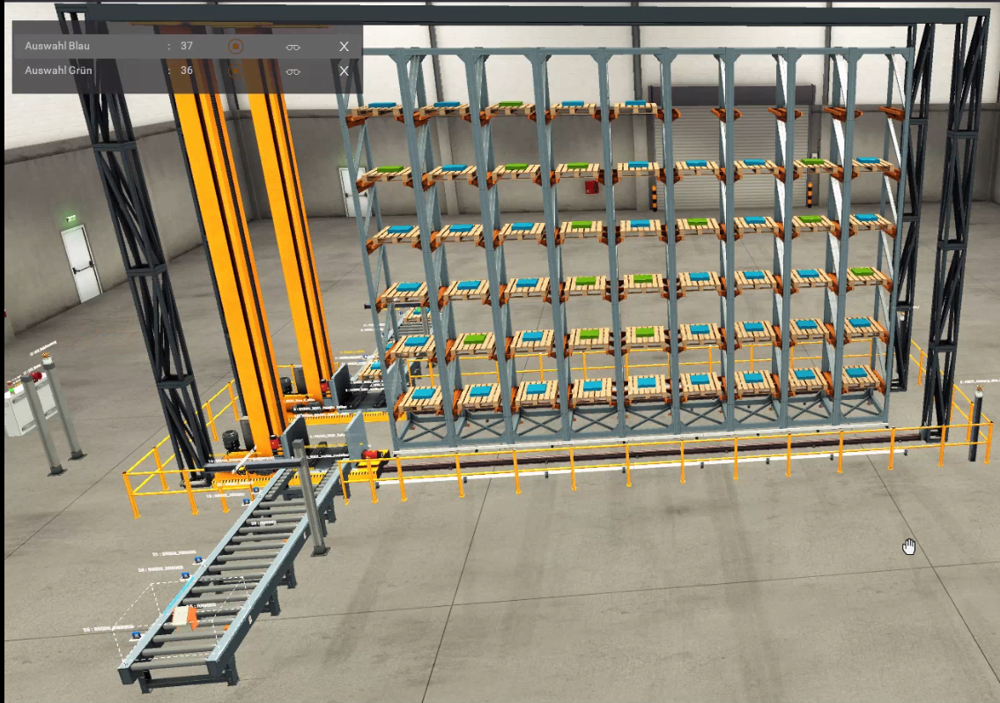
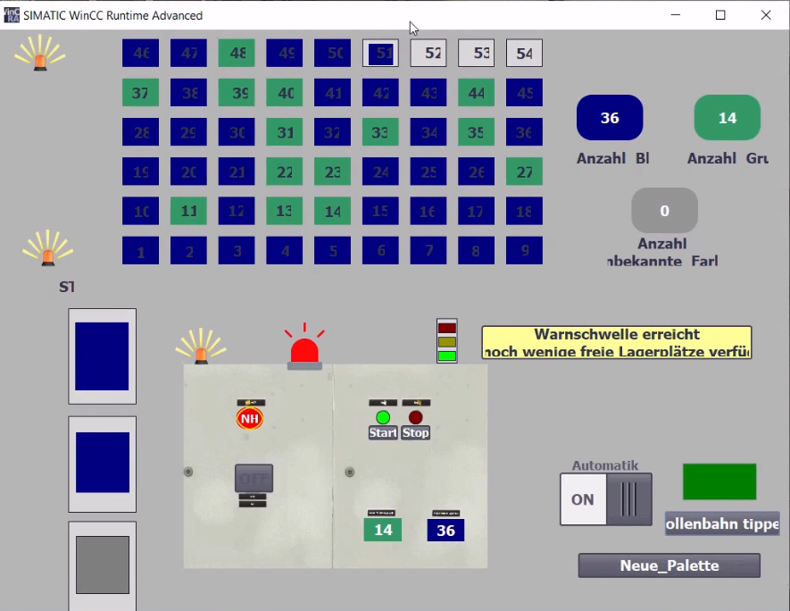

# 🚀 Projekt 049 – Automatisiertes Hochregallager mit Versand (Factory I/O & S7-300)

**Lager- und Versandsteuerung mit S7-GRAPH, SCL, FUP, WinCC Runtime Advanced und Factory I/O**

## 📌 Projektübersicht

Dieses Projekt verbindet die **Einlagerung und Auslagerung von Paletten** in einer gemeinsamen SPS-Steuerung. Die Anlage umfasst ein Hochregallager mit **54 Lagerfächern**, ein Regalstapelgerät sowie separate Rollenbahnstrecken für den Wareneingang und den Versand.

Die Steuerung ist mit einer **Siemens SIMATIC S7-300, CPU 314C-2 DP** in **TIA Portal V17** projektiert. **Factory I/O** bildet die Förder- und Lagertechnik als 3D-Simulation ab; **WinCC Runtime Advanced** visualisiert Lagerbelegung, Farberkennung, Zählwerte und Betriebszustände.

In der Lagerverwaltung werden die Paletten anhand ihrer Farbe **Blau** oder **Grün** erfasst, die zugehörigen Lagerfächer verwaltet und bei Bedarf für den Versand ausgewählt.



*Abbildung 1: Originalaufnahme der Factory-I/O-Simulation mit Regalstapelgerät, Lagerfächern und Rollenbahnstrecke.*

---

## 🎯 Projektziele

- **Einlagerung und Versand** in einem gemeinsamen SPS-Programm zusammenführen.
- Paletten über Rollenbahnen und das Regalstapelgerät transportieren.
- Die Materialfarbe mittels optischer Sensoren erkennen und in einem Datenbaustein speichern.
- Einen geeigneten freien Lagerplatz aus **54 Fächern** auswählen.
- Die Belegung, Farbzuordnung und Einlagerungszeit je Lagerfach verwalten.
- Bei einer Versandanforderung eine Palette nach **Blau** oder **Grün** auswählen und zur Übergabeposition transportieren.
- Die Belegungszahlen sowie freie Lagerplätze am **WinCC-HMI** darstellen.
- Bei Erreichen der Warnschwelle für wenige freie Plätze eine Meldung anzeigen.

## ⚙️ Verwendete Technologien

| Komponente | Beschreibung |
| --- | --- |
| SPS | Siemens SIMATIC S7-300 – **CPU 314C-2 DP** (Firmware V3.3 in der Projektdokumentation) |
| Engineering | **TIA Portal V17**, STEP 7 |
| SPS-Sprachen | **FUP**, **SCL**, **S7-GRAPH** und **AWL** |
| Simulation | **Factory I/O** (Szenendatei `.factoryio`) |
| Visualisierung | **SIMATIC WinCC Runtime Advanced** |
| Anlagenaufbau | Hochregal, Regalstapelgerät, Farbdetektion, Rollenbahnen |
| Lagerkapazität | **54 Lagerplätze** |
| Übergabeposition | **55**; Fachnummer **0** bedeutet Position halten |

---

## 🏗️ Anlagenstruktur und Prozessablauf

```text
          WARENEINGANG / LAGER
                  │
         Emitter und RB8001–8003
                  │
        Farbsensoren B8007/B8008
                  │
                  ▼
      Regalstapelgerät STAPL_8001
                  │
       Freies Fach suchen (1–54)
                  │
     Palette einlagern + DB aktualisieren
                  │
          ┌───────┴────────┐
          │  Hochregallager │
          │  Fach 1 ... 54 │
          └───────┬────────┘
                  │
           VERSANDANFORDERUNG
           Auswahl Blau / Grün
                  │
       Passende Palette suchen
                  │
      Regalstapelgerät STAPL_9001
                  │
          Übergabeposition 55
                  │
         Rollenbahn RB9001–9003
                  │
                  ▼
               VERSAND
```

### 🔹 Einlagerung

1. Die Palette wird von einem Emitter über die **Rollenbahnen RB8001–RB8003** bereitgestellt.
2. Die Sensoren `B8007_OT_BL` und `B8008_OT_GN` erkennen die Materialfarbe.
3. Das Regalstapelgerät übernimmt die Palette und fährt einen ausgewählten freien Lagerplatz an.
4. Nach dem Einlagern werden **Belegungsstatus, Farbcode und Einlagerungszeit** in den Lagerdaten gespeichert.
5. Die Zähler für blaue und grüne Paletten werden aus der Lagerbelegung ermittelt.

### 🔹 Auslagerung / Versand

1. Eine Versandanforderung wird über **Auswahl Grün (`S4`)** oder **Auswahl Blau (`S5`)** ausgelöst.
2. Die SPS ermittelt ein Lagerfach mit der gewünschten Farbe.
3. Das Versand-Stapelgerät holt die Palette aus dem Lagerfach.
4. Die Palette wird zur **Übergabeposition 55** transportiert und an die Versandrollenbahn übergeben.
5. Die Rollenbahnen transportieren die Palette über den Versandbereich weiter. Sensoren und Kontrollsignale unterstützen den Ablauf.

**Hinweis:** Die Ablaufbeschreibung fasst den Aufbau und die Funktion der Projektbausteine zusammen. Sie ist kein Nachweis einer vollständigen sicherheitstechnischen Abnahme aller Betriebsfälle.

---

## 🧱 SPS-Programmstruktur

Die folgenden Bausteine sind in der bereitgestellten TIA-Portal-Projektdokumentation enthalten:

| Baustein | Sprache | Funktion |
| --- | --- | --- |
| `Main [OB1]` | FUP | Zyklischer Aufruf der Lager- und Versandsteuerung |
| `Lager_Aufrufen [FB4]` | FUP | Zentrale Koordination des Lagerbereichs |
| `FB_Paketempfang_Rollenbahn [FB1]` | FUP | Materialannahme, Farberkennung, Steuerung der Eingangsrollenbahnen |
| `FB_Stapler_Ablauf [FB2]` | S7-GRAPH | Schrittgesteuerte Aufnahme und Einlagerung durch das Regalgerät |
| `FB_Lagerverwaltung [FB3]` | SCL | Lagerfachsuche, Farbzuordnung, Zählwerte und Warnschwellen |
| `FB_ControlPanel [FB10]` | FUP | Bedienpanel, Start-/Stopp-Bedingungen und Meldeleuchten |
| `FC_HMI_Bewegung [FC1]` | SCL | Positionsbezogene Bewegungsdaten für die Visualisierung |
| `600_Versand_Main [FB600]` | FUP | Übergeordnete Steuerung der Versandfunktionen |
| `621_Suche_neu [FB5]` | SCL | Fach-/Palettenauswahl und Versandanforderungen nach Farbe |
| `630_Lagerfach holen [FB630]` | SCL | Auslagerungsablauf des Versand-Regalstapelgeräts |
| `640_Rollenbahnen [FB640]` | FUP | Transport über die Versandrollenbahnen |
| `641_Rollenbahn [FB641]` | SCL | Wiederverwendbare Logik für eine Rollenbahn |
| `620_FB_Farbauswahl_Jewgeni_V2 [FB620]` | SCL | Zusätzlicher, im Projekt vorhandener Baustein zur Farbauswahl |

### Datenhaltung

| Datenbaustein | Zweck |
| --- | --- |
| `HochregallagerDB [DB1]` | Zentrale Lagerdaten, Belegung der 54 Lagerplätze, Positionen, Farben und Statuswerte |
| `FB_Paketempfang_Rollenbahn_DB [DB2]` | Instanzdaten für den Paletteneingang |
| `FB_Stapler_Ablauf_DB [DB3]` | Instanzdaten der Lager-Schrittkette |
| `FB_Lagerverwaltung_DB [DB4]` | Instanzdaten der Lagerverwaltung |
| `FB_ControlPanel_DB [DB7]` | Instanzdaten für Bedienung und Betriebsstatus |
| `HMI_Eingaben_DB [DB8]` | Von der WinCC-Oberfläche übergebene Eingaben |
| `Lager_Aufrufen_DB [DB9]` | Instanzdaten der Lagerkoordination |
| `600_Versand_Main_DB [DB10]` | Instanzdaten des Versand-Hauptbausteins |

**Architektur:** `OB1` ruft den Lagerbereich (`FB4`) und den Versandbereich (`FB600`) auf. Damit werden beide Funktionen innerhalb desselben SPS-Projekts koordiniert.

---

## 🧠 Lagerverwaltung in SCL

Die Funktion `FB_Lagerverwaltung [FB3]` arbeitet mit den 54 Lagerplätzen und führt unter anderem die folgenden Aufgaben aus:

- **Freien Lagerplatz finden:** aufsteigende Suche nach dem ersten freien Platz.
- **Einlagerdaten erfassen:** Farbe, Belegungsstatus und Datum/Uhrzeit abspeichern.
- **Lagerbestand auswerten:** blaue, grüne und unbekannte/falsch erkannte Materialien zählen.
- **Freigegebene Lagerplätze bereinigen:** veraltete Daten freier Fächer zurücksetzen.
- **Kapazität kontrollieren:** Warnung bei wenigen freien Plätzen beziehungsweise vollem Lager setzen.

### Farbkennzeichnung im Programm

| Farbcode | Bedeutung |
| --- | --- |
| `1` | Blau |
| `2` | Grün |
| `4` | Fehler / unklare Farberkennung |
| Sonstiger Code | Unbekannt |

### Warnschwelle

Im dokumentierten Bausteinaufruf ist die Warnschwelle auf **5 freie Lagerplätze** gesetzt. Die entsprechende Bedingung lautet:

```scl
#Warnung_Wenig_Freie_Plaetze :=
    #Anzahl_Freie_Plaetze <= #Warnschwelle_Freie_Plaetze;

#Lager_Voll := (#Anzahl_Freie_Plaetze = 0);
```

Damit unterscheidet die Logik zwischen einer knappen Lagerkapazität und einem vollständig belegten Lager.

---

## 🎛️ WinCC-HMI-Visualisierung



*Abbildung 2: Originalaufnahme der WinCC Runtime Advanced mit farbcodierter Fachbelegung und aktiver Warnmeldung.*

Die HMI-Oberfläche stellt unter anderem folgende Informationen dar:

- **54 nummerierte Lagerplätze** mit visueller Belegungs- und Farbdarstellung.
- **Anzahl Blau**, **Anzahl Grün** und **Anzahl unbekannter Farben**.
- Bedienung über **Start**, **Stopp**, **Automatik** und die dargestellten Material-/Palettenfunktionen.
- Betriebs- und Bewegungsanzeigen sowie Warnleuchten.
- Warnung bei Erreichen der eingestellten Mindestanzahl freier Lagerplätze.

### Auswertung des dargestellten Lagerzustands

| Zustand in der HMI-Aufnahme | Wert |
| --- | ---: |
| Belegte Plätze mit blauen Paletten | **36** |
| Belegte Plätze mit grünen Paletten | **14** |
| Unbekannte Farben | **0** |
| Summe belegter Lagerplätze | **50** |
| Verbleibende freie Lagerplätze | **4** |
| Konfigurierte Warnschwelle | **5** |
| Sichtbarer HMI-Status | **Warnschwelle erreicht** |

Da nur **4 von 54** Lagerplätzen frei sind, ist die Warnmeldung im Bild konsistent mit der im SCL-Baustein projektierten Warnschwelle.

Die Werte geben **den Zustand des Screenshots** wieder und sind keine dauerhaften Bestandswerte der Anlage.

---

## 🔌 Ausgewählte SPS-Signale

Die folgenden Adressen stammen aus dem bereitgestellten **TIA-Portal-Projektbericht**; die vollständige Signalzuordnung muss beim Öffnen des aktuellen `.zap17`-Archivs überprüft werden.

| Signal | Adresse | Beschreibung |
| --- | --- | --- |
| `S1_Not_Halt` | `%E0.1` | NOT-HALT-Signal |
| `S2_START` | `%E0.2` | Starttaster |
| `S3_STOP` | `%E0.3` | Stopptaster |
| `S4_Auswahl_GN` | `%E0.4` | Versandanforderung: Grün |
| `S5_Auswahl_BL` | `%E0.5` | Versandanforderung: Blau |
| `Factory_IO_RUN` | `%E1.7` | Betriebsstatus aus Factory I/O |
| `B8007_OT_BL` | `%E2.6` | Farbsensor: Blau im Wareneingang |
| `B8008_OT_GN` | `%E2.7` | Farbsensor: Grün im Wareneingang |
| `RB8001` / `RB8002` / `RB8003` | `%A2.0`–`%A2.2` | Rollenbahnen der Einlagerung |
| `STAPL_8001_Palette_heben` | `%A2.3` | Palette heben |
| `STAPL_8001_links_ausfahren` | `%A2.4` | Lastaufnahme nach links |
| `STAPL_8001_rechts_ausfahren` | `%A2.5` | Lastaufnahme nach rechts |
| `STAPL_8001_Fachposition` | `%AW20` | Zielposition des Lager-Regalstapelgeräts |
| `P14_Auswahl_GN` | `%A1.0` | Leuchtanzeige zur Grün-Auswahl |
| `P15_Auswahl_BL` | `%A1.1` | Leuchtanzeige zur Blau-Auswahl |
| `STAPL_9001_Palette_heben` | `%A4.3` | Palette auf der Versandseite heben |
| `STAPL_9001_links_ausfahren` | `%A4.4` | Versand-Regalgerät nach links ausfahren |
| `STAPL_9001_rechts_ausfahren` | `%A4.5` | Versand-Regalgerät nach rechts ausfahren |
| `STAPL_9001_Fachposition` | `%AW26` | Zielposition des Versand-Regalgeräts |

---

## 🧪 Test und Diagnose

Die bereitgestellten Screenshots dokumentieren die **Factory-I/O-Simulation** und eine **WinCC-Online-Anzeige**, darunter eine Situation mit aktiver Kapazitätswarnung. Für einen vollständigen Funktionstest sollten zusätzlich die folgenden Fälle geprüft und protokolliert werden:

| Testfall | Erwartetes Verhalten |
| --- | --- |
| Freier Lagerplatz vorhanden | Palette wird einem freien Fach zugeordnet |
| Einlagerung abgeschlossen | Fachstatus, Farbcode und Zählwerte sind aktualisiert |
| Versandanforderung Blau/Grün | Lagerfach mit passender Materialfarbe wird ausgewählt |
| Rollenbahn belegt | Keine widersprüchliche Übergabe an einen belegten Transportabschnitt |
| Nur noch 5 oder weniger Plätze frei | Kapazitätswarnung erscheint |
| Alle Lagerfächer belegt | Status „Lager voll“ wird erkannt |
| STOP-Befehl | Ablauf wird kontrolliert entsprechend den implementierten Stoppbedingungen beendet |
| NOT-HALT-Befehl | Aktorreaktion und Wiederanlaufsperre sind separat zu prüfen |

**Wichtig:** Das Vorhandensein einer NOT-HALT-Logik im Simulationsprojekt stellt **keinen Nachweis einer normgerechten Sicherheitsfunktion** dar. Diese erfordert bei einer realen Anlage eine eigene sicherheitstechnische Auslegung und Validierung.


---

## 👨‍💻 Projekt und Autor

**Wessam Abo Zayed**  
*Automatisierungstechnik | SPS-/PLC-Programmierung | Data Analyst*

Das Projekt entstand im Rahmen einer praktischen Teamarbeit. Das Programm enthält Bausteine aus mehreren Projektteilen; die vollständige Umsetzung und die Urheberschaft einzelner Bausteine sollten entsprechend den Originalquellen dokumentiert werden.

## 📬 Kontakt

| Plattform | Link |
| --- | --- |
| **E-Mail** | [abozayed.wessam@gmail.com](mailto:abozayed.wessam@gmail.com) |
| **LinkedIn** | [linkedin.com/in/wessam-abozayed](https://www.linkedin.com/in/wessam-abozayed/) |
| **GitHub** | [github.com/wessam-abo-zayed](https://github.com/wessam-abo-zayed) |
| **Tableau Public** | [public.tableau.com/app/profile/wessam3726](https://public.tableau.com/app/profile/wessam3726) |

---

*Lern- und Demonstrationsprojekt zur integrierten Lager- und Versandautomatisierung mit Factory I/O und Siemens SPS.*
